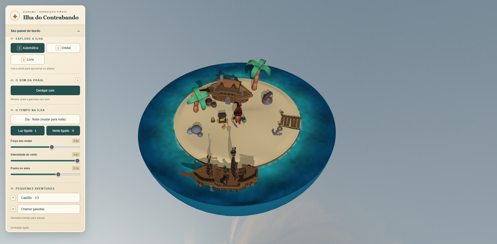

## 1. A Cena

A cena representa uma pequena ilha cercada pelo oceano, com uma casa de madeira, um cais, um navio pirata, palmeiras, tesouros, barris, caixas, rochas e outros elementos de ambientação. O personagem principal é um capitão pirata, que pode ser visualizado em três posições e orientações diferentes.

O ambiente possui animações e efeitos visuais, como ondas no mar, movimentação de um navio, vento nas palmeiras, partículas de poeira, gaivotas em movimento, música e sons ambientais, sombras dinâmicas e alternância entre dia e noite.

## 2. Criadores

Yan Pacheco e João Manoel

## 2. Media Kit

