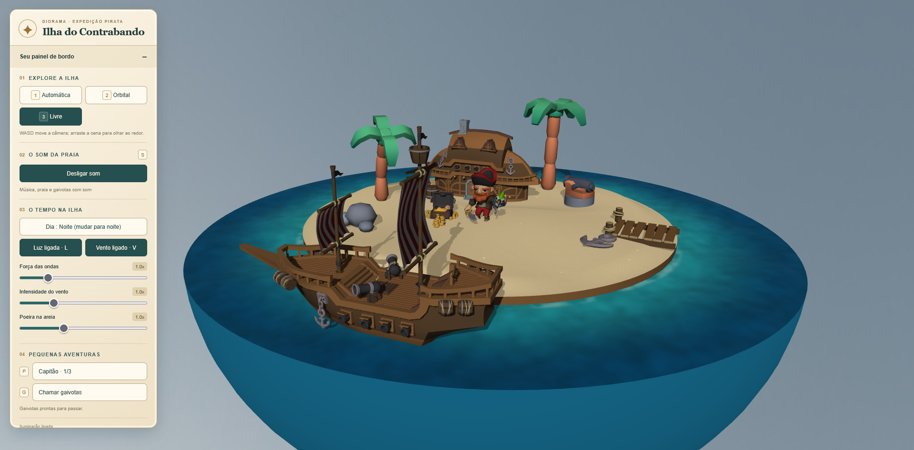
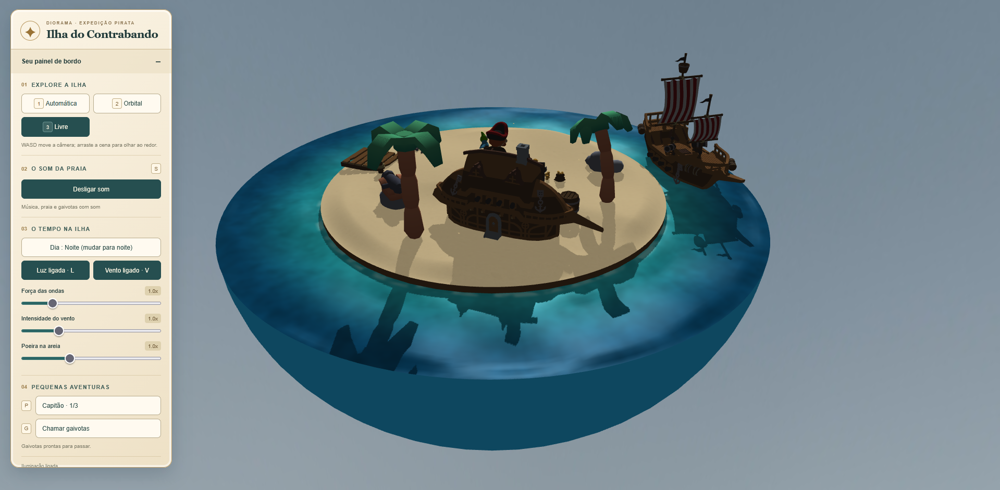

## 1. A Cena

A cena representa uma pequena ilha cercada pelo oceano, com uma casa de madeira, um cais, um navio pirata, palmeiras, tesouros, barris, caixas, rochas e outros elementos de ambientação. O personagem principal é um capitão pirata, que pode ser visualizado em três posições e orientações diferentes.

O ambiente possui animações e efeitos visuais, como ondas no mar, movimentação de um navio, vento nas palmeiras, partículas de poeira, gaivotas em movimento, música e sons ambientais, sombras dinâmicas e alternância entre dia e noite.

## 2. Criadores

Yan Pacheco e João Manoel

## 3. Media Kit

## 4. Opcionais

### Relativas ao Mundo
Modelos tridimensionais: Vários modelos tridimensionais foram utilizados.
Skybox, skyphere ou skydome: Foi utilizada uma imagem de Skybox.
Chão com relevo: O chão da praia tem um pequeno relevo.
Vários tipos de objetos: Além do pirata e das árvores, há outros objetos para serem observados.
Vento: As árvores se movem com o vento.
Líquido: No exterior da esfera, há água com ondas.

### Relativas ao Personagem
Poses alternativas: Há 3 posições possíveis para o pirata.
Interação: Ao clicar no pirata, ele faz um grunhido.

### Relativas à Câmera
Câmera de navegação livre: Há um terceiro modo possível na câmera.

### Relativas a Gráficos
Efeitos de partículas: Partículas da areia.
Ciclo dia/noite: O usuário pode alternar entre o dia e a noite.
Sombras: Os objetos possuem sombras.

### Outros opcionais
Música, efeitos sonoros e/ou som ambiente: Há efeitos sonoros na cena. A música da cena foi composta e produzida por João Manoel.

## 5. Créditos
Kenney Pirate Kit 2.1  
Quaternius Pirate Kit  
Rango Mango  
Joseph SARDIN / BigSoundBank  
Flying seagull — Poly by Google